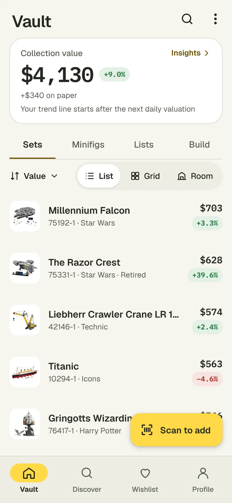
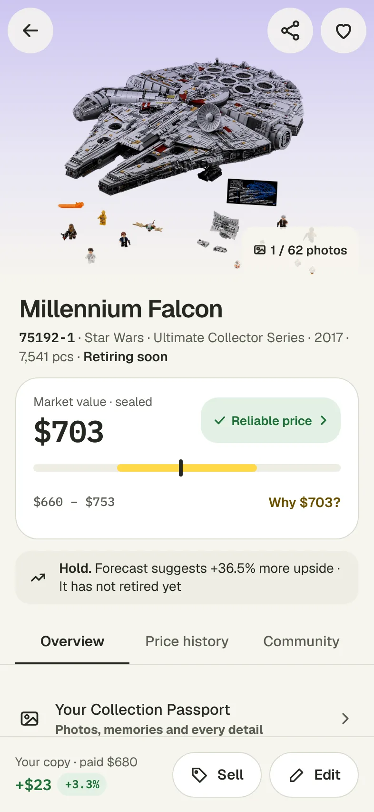
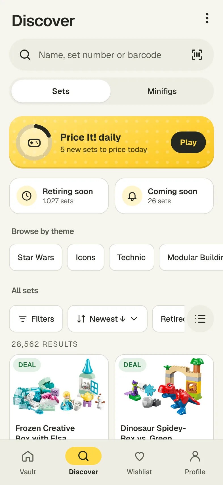
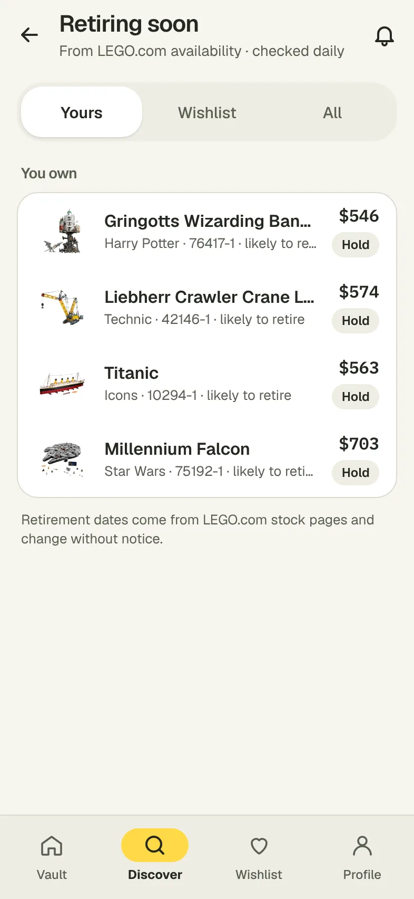
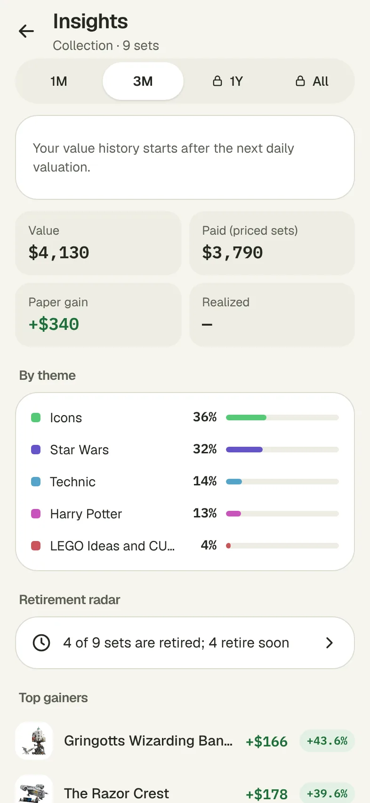
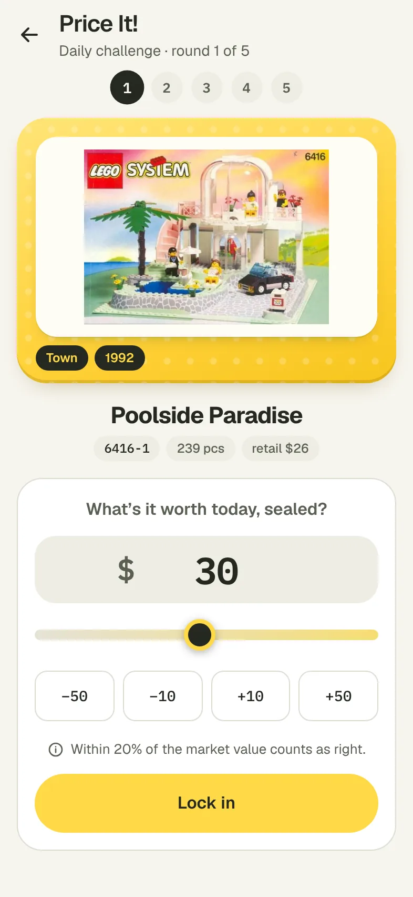
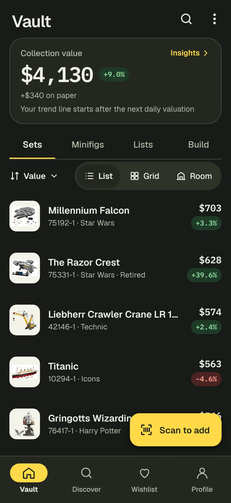
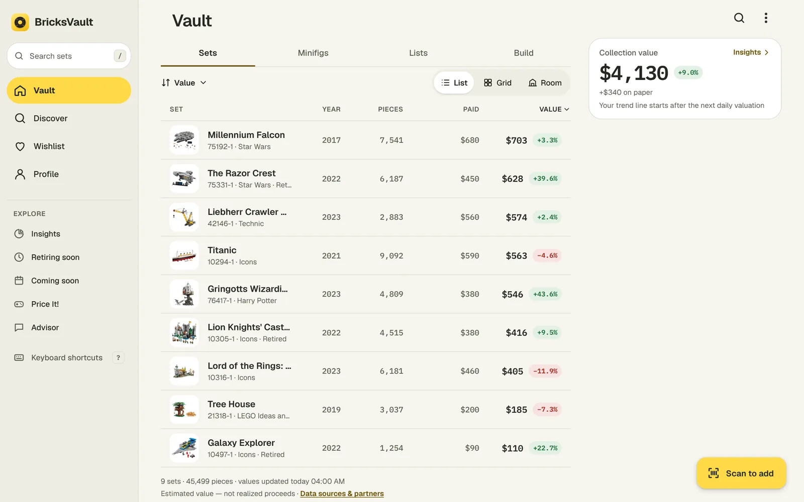
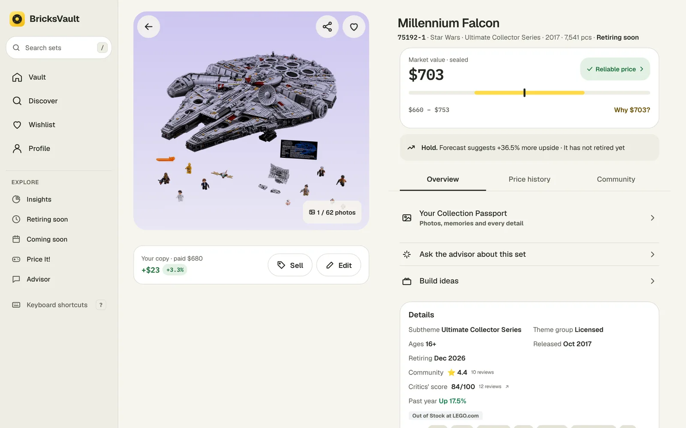

<div align="center">


# BricksVault

**Know what your LEGO collection is worth.**

BricksVault tracks the sets you own, prices them from real market sales, and
tells you which ones are about to retire. It runs on the web and as an Android app.

[**Open bricksvault.app**](https://bricksvault.app)

[](https://github.com/yarik1390/MyBricks/actions/workflows/deploy-worker.yml)
[](https://github.com/yarik1390/MyBricks/actions/workflows/pr-checks.yml)
[](https://github.com/yarik1390/MyBricks/actions/workflows/e2e-smoke.yml)
[](https://github.com/yarik1390/MyBricks/actions/workflows/a11y.yml)





</div>

## What you can do with it

- **See your collection's value.** Every set gets a market value with a low/high
  range, a confidence label, and a "Why this price?" breakdown of the sales behind it.
- **Track gains.** Enter what you paid and the Vault shows paper gain per set and
  overall, with value history and a theme breakdown in Insights.
- **Catch retirements.** Retiring soon lists sets LEGO has confirmed are leaving
  shelves, plus the ones we expect to retire, with alerts for your sets and wishlist.
- **Find sets fast.** Search about 28,000 sets and 17,000 minifigures by name,
  set number or barcode, or scan a box with the camera.
- **Watch prices.** Add sets to your wishlist and get a push or email when the
  price drops below your target. Compare stores shows current prices at major retailers.
- **Play Price It!** A daily five-round game: guess what a set is worth today.
- **Share.** A public profile and shareable set links with rich previews.

Sign-in is optional. Guests get the full app with data kept on the device;
signing in syncs the collection across devices.

<details>
<summary><b>More screenshots</b></summary>
<br>

| Retiring soon | Insights | Price It! | Dark theme |
|---|---|---|---|
|  |  |  |  |

**On desktop**





</details>

## How prices work

Values are built from several independent sources (BrickLink sales,
PriceCharting, eBay listings and community-reported sales),
weighted by how recent and how plentiful the data is. For sets with no recent
sales, an in-house model trained on real sales estimates the value from theme,
age, years since retirement, piece count and retail price. Every number on a
set page says how confident it is and where it came from. Values are stored in
USD and shown in the user's currency.

## Stack

| Layer | Choice |
|---|---|
| API | Cloudflare Workers, TypeScript, [Hono](https://hono.dev) |
| Data | Cloudflare D1 (SQLite), KV cache, R2 for photos |
| Auth | Supabase JWT, verified in the Worker |
| Frontend | Vanilla JS single-page app: ES modules, hash routing, `morphdom`, no framework and no build step |
| Hosting | Cloudflare Pages (static) and Workers (API) |
| AI | Gemini and OpenAI through Cloudflare AI Gateway, with bring-your-own-key support |
| Mobile | Capacitor (Android), RevenueCat billing |
| CI/CD | GitHub Actions: checks on every PR, auto-deploy on merge |

The app is available in 9 languages (English, German, Spanish, French, Hindi,
Japanese, Dutch, Ukrainian, Chinese) with light and dark themes.

## Repository map

```
public/           the web app, served by Cloudflare Pages
  js/views/       one module per screen (Vault, Discover, set page, Insights, ...)
  js/components/  advisor chat, scanner, sheets, onboarding
  js/locales/     translations
  sw.js           service worker (bump VERSION when cached assets change)
worker/           the API
  src/routes/     one Hono sub-app per resource
  src/jobs/       scheduled jobs: valuations, imports, snapshots, alerts
  src/lib/        pricing integrations and pure helpers
  schema.sql      D1 schema for fresh databases
  wrangler.toml   bindings, vars and cron triggers
android/          Capacitor shell
store/            Play Store listing text and images
e2e/ a11y/ load/  Playwright end-to-end, axe accessibility and k6 load tests
```

## Development

```bash
# API (from worker/)
npm ci
npm run typecheck        # tsc --noEmit
npx vitest run           # runs inside workerd
npx wrangler dev         # needs .dev.vars, see worker/.dev.vars.example

# Web app (from the repo root)
npm ci
npm test                 # UI strings, i18n checks and unit tests
npx biome lint
npm run e2e              # Playwright, against a stubbed API
```

Pull requests run the same gates as the deploy
([`pr-checks.yml`](.github/workflows/pr-checks.yml)): frontend tests, Biome,
a strict type check of the shared helpers, the Worker type check and the
Worker test suite.

## Android

The same `public/` bundle ships as an Android app through Capacitor. The app
id is `app.bricksvault`; the version code is derived from the commit count, so
it is never bumped by hand. Native features include ML Kit barcode scanning,
biometric unlock, push notifications and Google Play billing via RevenueCat.

Builds are a manual workflow run of
[`build-android.yml`](.github/workflows/build-android.yml). It signs the bundle
and pushes the `.aab` and its ProGuard mapping to the `aab-delivery` branch,
which is a release channel and should not be deleted.

```bash
npx cap sync android      # after any change in public/
npm run android:preflight # checks app id, version and store metadata
```

## Deploying

Merging to `main` runs [`deploy-worker.yml`](.github/workflows/deploy-worker.yml):
it applies schema migrations to D1, deploys the Worker, then deploys Pages.
Two rules that have broken deploys before:

- D1 rejects `ALTER TABLE ... ADD COLUMN IF NOT EXISTS`. New columns go in both
  `worker/schema.sql` and `worker/schema_migrate.sql`.
- Cron strings use day names: `0 4 * * SUN`, not `0 4 * * 0`.

## Documentation

| Doc | Contents |
|---|---|
| [`AGENTS.md`](./AGENTS.md) | Full engineering handoff: architecture, data model, API, deploy pipeline, gotchas |
| [`CLAUDE.md`](./CLAUDE.md) | Short conventions for AI coding agents |
| [`PRICING-AUDIT.md`](./PRICING-AUDIT.md) | How the valuation blend works |
| [`HANDOFF-sources.md`](./HANDOFF-sources.md) | Notes on each pricing source |

## License

No license: **all rights reserved**. The source is public to read but not
licensed for reuse, redistribution or derivative works.

LEGO is a trademark of the LEGO Group, which does not sponsor, authorize or
endorse this project.
